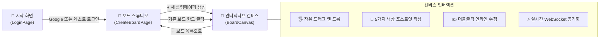

<div align="center">

# 🎈 디지털 롤링페이퍼 (Interactive Rolling Paper)
### 소중한 사람에게 마음을 전하는 가장 따뜻하고 자유로운 방법

<p align="center">
  
  
  
  
  
  
</p>

<p align="center">
  <b>벽에 포스트잇을 붙이고 자유롭게 드래그하며, 실시간으로 함께 축하하는 반응형 롤링페이퍼 플랫폼</b>
</p>

---

</div>

<br/>

## 🌟 핵심 특징 (Key Highlights)

| 기능 | 설명 | 기술적 특징 |
| :--- | :--- | :--- |
| **🪄 자유로운 드래그** | 보드 캔버스 안에서 포스트잇을 마우스로 잡고 자유롭게 이동 | Framer Motion 물리 탄성(`dragElastic`) 및 경계면 제한(`dragConstraints`) |
| **⚡ 새로고침 없는 실시간 동기화** | 다른 사람이 글을 쓰거나 옮기면 즉시 내 화면에도 0.1초 만에 반영 | Supabase WebSocket Realtime (`postgres_changes`) |
| **🎨 5가지 감성 파스텔 톤** | 옐로우, 핑크, 그린, 블루, 퍼플의 눈이 편안한 파스텔 팔레트 | Tailwind CSS 맞춤형 테마 및 아날로그 테이프/핀 뱃지 |
| **✍️ 더블클릭 인라인 수정** | 포스트잇을 따닥! 더블클릭하면 즉시 별명, 본문, 색상 변경 가능 | `Ctrl + Enter` 저장 단축키, `Esc` 취소, 드래그 자동 잠금 |
| **💌 롤링페이퍼 스튜디오** | 누구나 원하는 대상에게 보드를 생성하고 테마를 지정 | 4가지 배경 테마(노을, 라벤더, 민트, 크림) & 보드 목록 뷰 |
| **🔐 유연한 인증 시스템** | 구글 공식 소셜 로그인 및 외부 설정 없는 1초 테스트 게스트 로그인 지원 | OAuth 2.0 PKCE Flow & Supabase Anonymous Auth |

<br/>

---

## 🎨 디자인 시스템 (UI/UX Design System)

### 1. 5가지 파스텔 컬러 팔레트
아날로그 포스트잇의 따뜻한 감성을 재현하며, 본문 텍스트의 가독성을 최우선으로 고려한 색상 배색입니다.

```
💛 Pastel Yellow : #FEF9C3 (클래식 감사/축하)
💖 Pastel Pink   : #FCE7F3 (다정한 응원과 사랑)
💚 Pastel Green  : #DCFCE7 (격려와 긍정의 메시지)
💙 Pastel Blue   : #E0F2FE (차분한 조언과 축복)
💜 Pastel Purple : #F3E8FF (특별한 추억과 기념)
```

### 2. 글자 수 입력 UX 규칙
- **최대 글자 수**: 150자 (공백 포함)
- **실시간 피드백 카운터**:
  - `0 ~ 130자`: 은은한 그레이 (`text-gray-400`)
  - `131 ~ 149자`: 주의 경고 주황색 (`text-amber-500 font-semibold`)
  - `150자 도달`: 제한 빨간색 (`text-rose-500 font-bold`) 및 추가 입력 자동 차단

<br/>

---

## 🏗️ 서비스 화면 구성 및 사용자 여정 (User Journey)



<br/>

---

## 📂 프로젝트 구조 (Project Structure)

```bash
inter_board/
├── public/                 # 정적 리소스 및 파비콘
├── src/
│   ├── components/         # 핵심 UI 컴포넌트
│   │   ├── LoginPage.tsx        # 1. 앱 시작 로그인 랜딩 화면
│   │   ├── CreateBoardPage.tsx   # 2. 보드 생성 및 목록 스튜디오 화면
│   │   ├── PostItCard.tsx       # 3. 드래그 & 더블클릭 수정 포스트잇 카드
│   │   ├── NewPostItModal.tsx   # 4. 150자 제한 포스트잇 작성 모달
│   │   └── LoginModal.tsx       # 5. Shadcn/ui 스타일 로그인 다이얼로그
│   ├── types.ts            # 포스트잇, 보드, 컬러 타입 정의
│   ├── App.tsx             # 메인 라우팅 & 실시간 동기화 오케스트레이터
│   ├── main.tsx            # React 루트 진입점
│   └── index.css           # Tailwind CSS 디렉티브
├── lib/
│   ├── supabase.ts         # PKCE 적용 Supabase 클라이언트 인스턴스
│   └── auth.ts             # Google OAuth, 게스트 로그인 & 세션 리스너
├── Feature_Specs_Board.md  # 상세 기능명세서 기획 문서
├── tailwind.config.js      # 테일윈드 설정 (파스텔 테마 확장)
└── vite.config.ts          # Vite 번들러 설정
```

<br/>

---

## ⚡ 빠른 시작 가이드 (Quick Start)

### 1. 저장소 클론 및 패키지 설치
```bash
git clone https://github.com/jihunyangAI/inter_board.git
cd inter_board
npm install
```

### 2. 환경변수 설정
`.env.example` 파일을 복사하여 `.env` 파일을 생성하고 Supabase 프로젝트 정보를 입력합니다:
```bash
cp .env.example .env
```

```env
# .env
VITE_SUPABASE_URL=https://<your-project-id>.supabase.co
VITE_SUPABASE_ANON_KEY=<your-supabase-anon-key>
```

### 3. 로컬 개발 서버 실행
```bash
npm run dev
```
브라우저에서 **`http://localhost:5173`** 에 접속하여 서비스를 즐겨보세요!

<br/>

---

## 🔒 보안 및 모범 사례 (Security & Best Practices)

- **PKCE Flow 적용**: 모바일 및 SPA 환경에서 인가 코드 가로채기 공격을 원천 차단하는 OAuth 2.0 PKCE 인증 플로우 적용
- **환경변수 격리**: 관리자 전용 비밀 토큰(Service Role / PAT)은 클라이언트에 노출하지 않으며, 안전한 `anon key`만 `.env`로 관리
- **Realtime 최적화**: 드래그 이동 중에는 60fps GPU 가속으로만 렌더링하고, 마우스를 놓는 순간(`onDragEnd`)에만 단 1회의 DB 업데이트를 전송하여 네트워크 부하 최소화

<br/>

---

## 📄 라이선스 (License)

This project is licensed under the **MIT License**.  
누구나 자유롭게 수정하고 활용할 수 있습니다.

<br/>

<div align="center">
  <sub>Made with ❤️ by <b>jihunyangAI</b> and <b>Antigravity AI Pair Programmer</b></sub>
</div>
